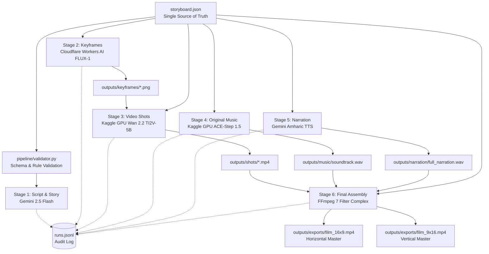
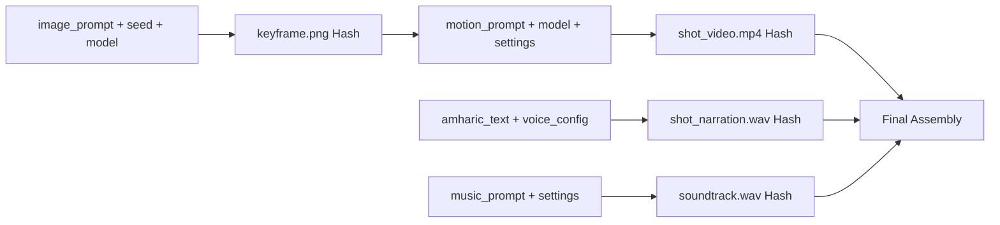

# AI Heritage Short — Architecture Documentation

This document describes the architectural foundations, component interactions, data flows, and design decisions of the **AI Heritage Short** filmmaking pipeline.

---

## 1. Architectural Philosophy

1. **Single Source of Truth (`storyboard.json`)**: Every asset, prompt, timing parameter, character trait, and translation originates strictly from the validated storyboard document. No rogue configuration files or ad-hoc prompt scripts.
2. **Deterministic Content-Addressed Caching**: Work is cached based on hashing inputs, seeds, models, and dependencies. If an input hasn't changed, expensive external API or GPU calls are skipped.
3. **Granular Dependency DAG**: Modifying one shot does not trigger a complete project re-render. Keyframe changes cascade only to the affected video shot.
4. **Honest Observability**: Calls to external models are logged to `runs.jsonl` with real measurements. Latencies, costs, and token counts are never fabricated.
5. **Decoupled Compute**: Keyframe generation, narration TTS, and assembly run lightweight locally/cloud-API, while heavy video diffusion (Wan 2.2) and music synthesis (ACE-Step) run decoupled on GPU clusters (Kaggle).

---

## 2. Pipeline Data Flow



---

## 3. Component Breakdown

### 3.1 `pipeline/config.py`
Centralizes environment variables and configuration objects:
- `GeminiConfig`: Text and TTS models, endpoints, and credentials.
- `CloudflareConfig`: Account ID, API token, FLUX model identifier.
- `KaggleConfig`: Username, API key, notebook slugs.
- `FFmpegConfig`: Binary locations.
- `PipelineConfig`: Root directories for cache, outputs, and storyboard.

### 3.2 `pipeline/validator.py`
Enforces structural and domain constraints:
- Validates against `schema/storyboard.schema.json` (Draft 2020-12).
- Validates shot count (8–12 shots).
- Validates total duration (60.0s – 90.0s).
- Enforces unique shot IDs.
- Verifies that all `character_reference_ids` correspond to declared `character_references`.
- Verifies presence of Amharic narration and English translation.

### 3.3 `pipeline/cache.py`
Implements the content-addressed caching engine:
- Computes SHA-256 hashes of input payloads.
- Checks `outputs/` existence and non-zero byte size.
- Maintains `.cache/manifest.json`.
- Exposes stage-level and key-level invalidation APIs.

### 3.4 `pipeline/logger.py`
Implements append-only structured logging to `runs.jsonl`:
- Captures UTC timestamps, provider names, models, seeds, and execution durations.
- Leaves unmeasured metrics as `null` rather than generating simulated numbers.

### 3.5 `pipeline/providers/`
Encapsulates external model communication:
- `base.py`: Handles exponential backoff retries (`retry_with_backoff`) for HTTP 429, 502, 503, 504 while halting immediately on HTTP 401/403 authentication failures.
- `gemini.py`: Generates narrative refinements and Amharic speech audio.
- `cloudflare.py`: Interfaces with Cloudflare Workers AI for FLUX-1 Schnell image generation.
- `kaggle.py`: Generates input manifests (`wan_batch.json`, `acestep_batch.json`) and handles automated or manual Kaggle GPU execution.

### 3.6 `pipeline/utils/ffmpeg.py`
Handles media engineering:
- **Audio Ducking**: Implements dynamic sidechain compression:
  ```
  [2:a]volume=0.35[bgm];
  [bgm][1:a]sidechaincompress=threshold=0.125:ratio=4:attack=20:release=300[ducked];
  [1:a][ducked]amix=inputs=2:duration=first:dropout_transition=2,loudnorm=I=-16:TP=-1.5:LRA=11[aout]
  ```
- **Aspect Ratio Filtering**:
  - `9:16`: `scale=1080:1920:force_original_aspect_ratio=increase,crop=1080:1920:(in_w-1080)/2:(in_h-1920)/2,setsar=1`
  - `16:9`: `scale=1920:1080:force_original_aspect_ratio=increase,crop=1920:1080:(in_w-1920)/2:(in_h-1080)/2,setsar=1`
- **Subtitles**: Converts English translations to standardized `.srt` format with millisecond timecodes.
- **End Card**: Constructs `drawtext` video overlay with AI disclosure statement.

---

## 4. Cache Dependency DAG



If `image_prompt` for shot 1 changes:
1. Keyframe 1 hash changes $\to$ Keyframe 1 regenerated.
2. Shot 1 video hash changes $\to$ Shot 1 video regenerated.
3. Shots 2–10 remain completely untouched and reused from cache.

